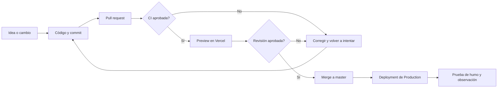
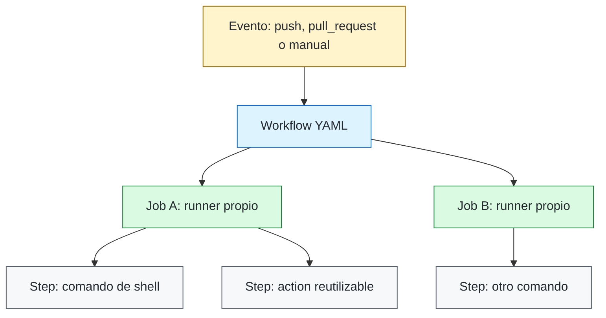
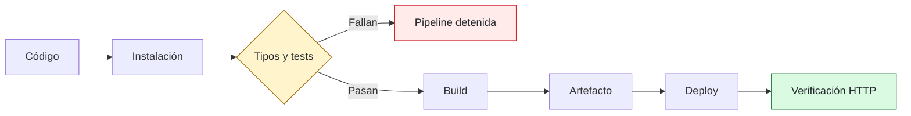
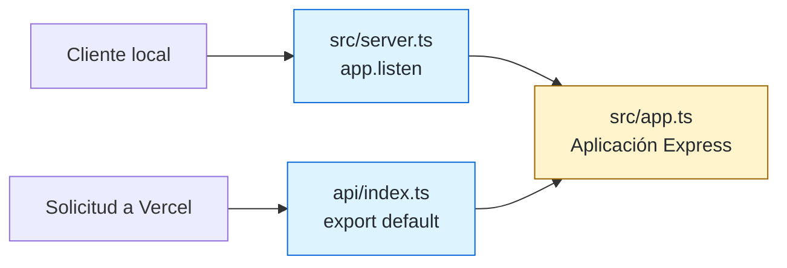
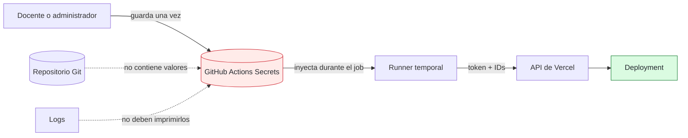
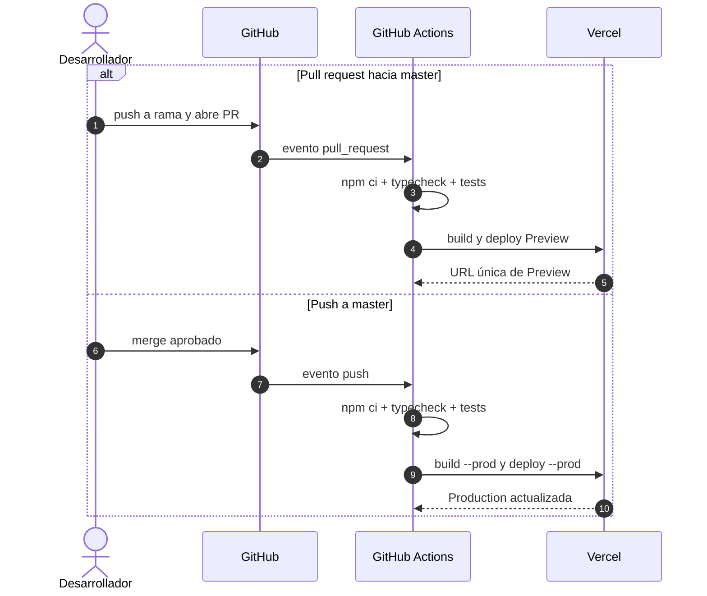
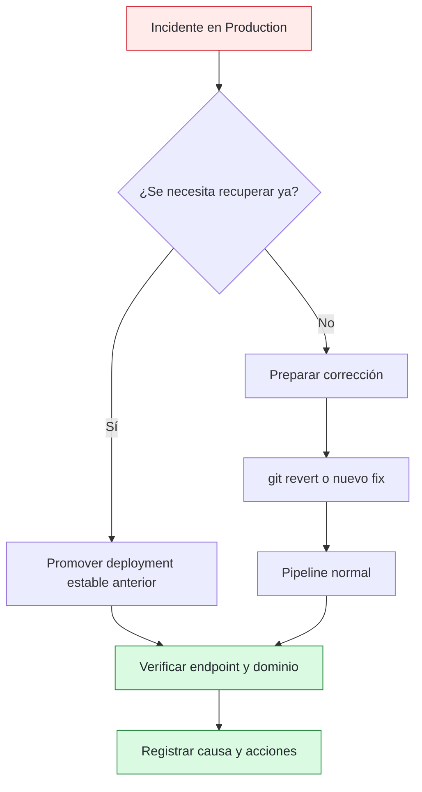
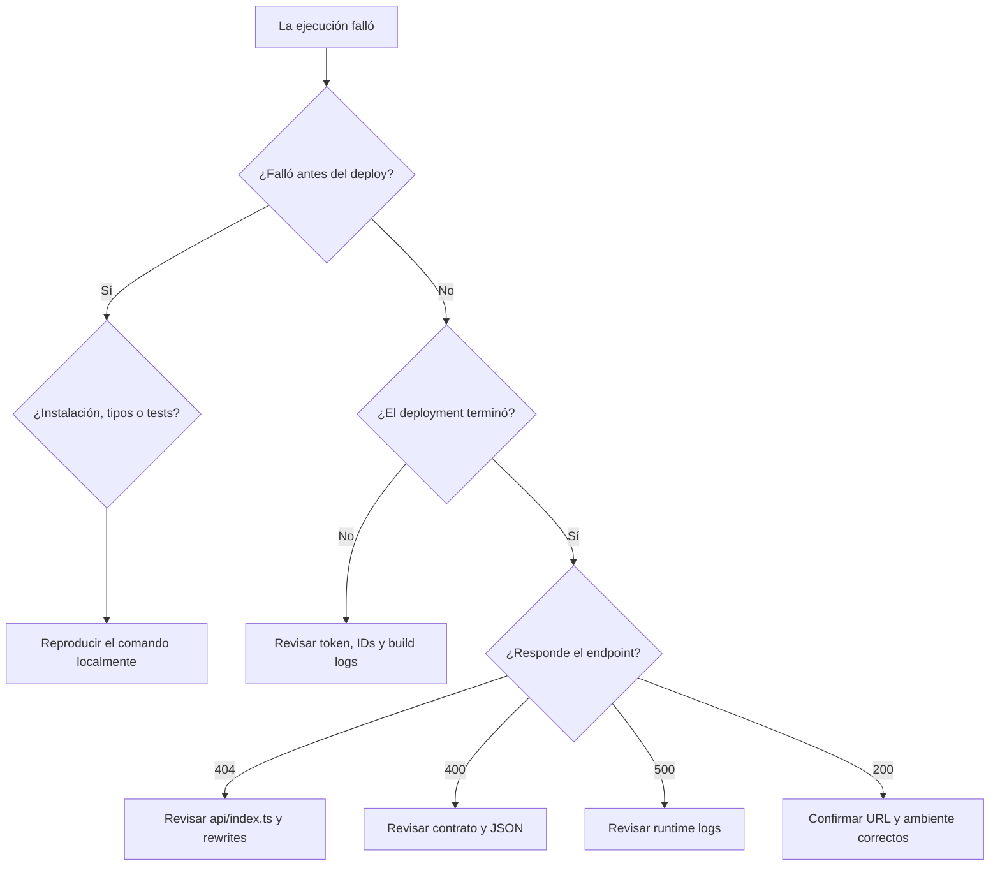

# Despliegue continuo en Vercel con GitHub Actions

Material de clase — **Diseño y Arquitectura de Despliegue I, UPC**


En esta práctica vamos a publicar el Bot de Casas, una API HTTP desarrollada con TypeScript y Express, y a automatizar sus despliegues con GitHub Actions. Al finalizar, cada cambio propuesto en un *pull request* podrá generar un ambiente de prueba (*Preview*) y cada cambio integrado en `master` podrá llegar al ambiente de producción.

> La URL de la aplicación no muestra una página web. Este proyecto expone `POST /move`; por eso se prueba enviando JSON con PowerShell, `curl` o un cliente de APIs.

> [!TIP]
> Conviene leer primero las secciones 1 a 4 sin ejecutar comandos. Allí se construye el modelo mental; desde la sección 5 se aplica ese modelo al proyecto.

## Mapa visual del recorrido



## 1. Objetivos de aprendizaje

Al completar la práctica deberían poder:

- diferenciar automatización, integración y orquestación;
- distinguir compilación, integración continua y despliegue continuo;
- describir evento, workflow, job, step, action, runner, artifact, environment y secret;
- explicar qué responsabilidades tienen GitHub, GitHub Actions y Vercel;
- adaptar un servidor Express persistente a una función *serverless*;
- administrar credenciales mediante *secrets*;
- construir una sola vez y desplegar exactamente ese artefacto;
- diferenciar despliegues Preview y Production;
- verificar, diagnosticar y revertir un despliegue.

## 2. La aplicación que vamos a desplegar

El repositorio contiene:

| Elemento | Responsabilidad |
| --- | --- |
| `src/app.ts` | Crea y configura la aplicación Express. Registra `POST /move` y el manejo de errores. |
| `src/server.ts` | Abre un puerto con `app.listen`; se usa en ejecución local tradicional. |
| `src/move.ts` | Atiende la solicitud HTTP. |
| `src/state.ts` | Valida el estado recibido. |
| `src/strategy.ts` | Decide los movimientos. |
| `test/move.test.ts` | Pruebas automáticas con Jest. |
| `fixtures/*.json` | Estados de ejemplo para probar la API. |
| `package.json` | Dependencias y scripts de compilación, tipos y pruebas. |

Los comandos relevantes ya definidos son:

```text
npm run build       # compila TypeScript en dist/
npm run typecheck   # verifica tipos sin generar archivos
npm test            # ejecuta Jest
npm run dev         # servidor local con recarga
```

En un servidor tradicional, `src/server.ts` inicia un proceso que queda escuchando en un puerto. Vercel usa otro modelo: ante una solicitud ejecuta una función y le entrega la petición. Por eso la función debe **exportar** la aplicación Express y no debe ejecutar `app.listen`.

## 3. Marco teórico: de un cambio de código a un despliegue

Antes de configurar herramientas conviene entender el problema que resuelven. Escribir código y ejecutarlo en una computadora no alcanza para operarlo de forma confiable. Entre un cambio y su llegada a usuarios aparecen preguntas como estas:

- ¿el proyecto puede instalarse desde cero?;
- ¿compila en una máquina distinta de la del desarrollador?;
- ¿las pruebas siguen pasando?;
- ¿qué versión exacta fue publicada?;
- ¿quién autorizó que llegara a producción?;
- ¿cómo volvemos a una versión anterior si falla?

Una **pipeline de entrega de software** es la secuencia automatizada de controles y transformaciones que responde esas preguntas. Recibe código fuente como entrada y puede producir evidencia de validación, artefactos y despliegues como salida.

### 3.1 Automatización, integración y orquestación

Estos términos se relacionan, pero no son sinónimos:

- **Automatización:** hacer que una tarea repetible se ejecute mediante instrucciones, por ejemplo `npm test`.
- **Integración:** conectar sistemas para que intercambien información o disparen procesos. Por ejemplo, GitHub puede avisar que hubo un `push` y Vercel puede recibir un artefacto.
- **Orquestación:** coordinar varias tareas, dependencias, condiciones, credenciales y resultados dentro de un flujo completo.

GitHub Actions puede actuar como plataforma de **automatización y orquestación**. También integra GitHub con servicios externos, pero llamarlo solamente “un integrador” queda corto: además decide cuándo ejecutar, prepara máquinas, ordena tareas, evalúa condiciones, conserva resultados y reporta estados.

### 3.2 Integración continua, entrega continua y despliegue continuo

Las siglas **CI/CD** agrupan prácticas diferentes:

| Práctica | Pregunta que responde | Resultado típico |
| --- | --- | --- |
| Integración continua (*Continuous Integration*) | ¿Este cambio puede integrarse sin romper el sistema? | Build y pruebas aprobados o rechazados. |
| Entrega continua (*Continuous Delivery*) | ¿Existe una versión validada y lista para publicar? | Artefacto desplegable, con publicación de Production todavía aprobada manualmente. |
| Despliegue continuo (*Continuous Deployment*) | ¿Todo cambio que supera los controles debe llegar automáticamente a Production? | Publicación automática después de las puertas de calidad. |

CI no significa solamente “usar un servidor de CI”. Es una práctica de integrar cambios pequeños y frecuentes, verificarlos automáticamente y obtener retroalimentación rápida. CD extiende esa práctica hasta la preparación o publicación del software.

En esta clase implementaremos CI más despliegue continuo para `master`: un cambio debe superar controles automáticos y luego el pipeline lo publica. En una organización real podría agregarse una aprobación manual; en ese caso hablaríamos de entrega continua en ese último tramo.

### 3.3 ¿Qué es GitHub Actions?

**GitHub Actions es la plataforma de automatización y CI/CD integrada en GitHub.** Observa eventos que ocurren alrededor de un repositorio y, de acuerdo con archivos de configuración versionados junto al código, ejecuta tareas en máquinas llamadas *runners*.

Su modelo tiene las siguientes piezas:

| Concepto | Significado | Ejemplo de esta clase |
| --- | --- | --- |
| Evento | Hecho que puede iniciar una automatización. | `pull_request`, `push`, ejecución manual. |
| Workflow | Proceso automatizado completo, definido en YAML. | Validar y desplegar en Vercel. |
| Job | Grupo de pasos que se ejecuta en un runner. | `validate-and-deploy`. |
| Step | Unidad secuencial dentro de un job. | Ejecutar `npm test`. |
| Action | Componente reutilizable que encapsula una tarea. | `actions/checkout` descarga el repositorio. |
| Runner | Máquina que ejecuta un job. | Una VM temporal con Ubuntu. |
| Secret | Dato cifrado que el workflow puede consumir sin versionarlo. | `VERCEL_TOKEN`. |
| Variable | Configuración no secreta disponible durante la ejecución. | Un nombre de ambiente. |
| Artifact | Archivo producido y conservado por una ejecución. | Reporte de pruebas o paquete compilado. |
| Environment | Contexto lógico con variables, secretos y reglas propias. | `preview` o `production`. |

#### Workflow, job, step y action no son lo mismo

La jerarquía puede leerse así:



Un **workflow** describe la automatización completa. Un **job** reserva un runner y agrupa pasos. Los **steps** de un mismo job comparten el sistema de archivos y se ejecutan en orden. Los jobs, en cambio, son independientes y pueden ejecutarse en paralelo salvo que se declare una dependencia con `needs`.

Una **action** no es el workflow entero: es una pieza reutilizable que se invoca desde un step. Por ejemplo, `actions/checkout@v4` evita tener que programar manualmente la descarga del repositorio.

#### El runner y la reproducibilidad

El runner hospedado por GitHub es una máquina temporal. Para cada job:

1. se crea un entorno limpio;
2. se descarga el código cuando el workflow lo solicita;
3. se instalan dependencias y herramientas;
4. se ejecutan los pasos;
5. se reporta el resultado;
6. se descarta la máquina.

Esto explica por qué “en mi máquina funciona” no es evidencia suficiente. Si el pipeline necesita un archivo no versionado, una dependencia instalada globalmente o una credencial local, fallará. La automatización obliga a declarar las dependencias del proceso y mejora la reproducibilidad.

#### ¿Qué garantiza GitHub Actions y qué no?

Un workflow verde garantiza solamente que las instrucciones configuradas terminaron correctamente. No demuestra por sí solo que el software sea correcto, seguro o útil. Si no escribimos una prueba para un comportamiento, la pipeline no puede inventarla. La calidad del resultado depende de la calidad de las puertas que diseñemos.

GitHub Actions tampoco aloja la aplicación final en esta arquitectura. Ejecuta el proceso de CI/CD y entrega el resultado a Vercel. Cuando termina el job, el runner desaparece; la aplicación continúa ejecutándose en Vercel.

### 3.4 ¿Qué es una pipeline y qué son las puertas de calidad?

Una pipeline suele organizarse en etapas conceptuales:



Cada etapa puede funcionar como una **puerta de calidad**. Si una puerta falla, las etapas posteriores no deberían ejecutarse. Por ejemplo, no tiene sentido publicar una versión que no compila o cuyas pruebas fallan.

Ordenar los controles desde los más rápidos y baratos hacia los más costosos reduce tiempo y consumo de infraestructura. Para este proyecto elegimos:

1. instalar dependencias reproduciblemente con `npm ci`;
2. validar tipos con `npm run typecheck`;
3. ejecutar pruebas con `npm test`;
4. construir para Vercel;
5. desplegar solamente si todo lo anterior pasó.

### 3.5 Código fuente, build, artefacto y despliegue

También hay que distinguir cuatro objetos:

- **Código fuente:** los archivos que editamos y versionamos.
- **Build:** el proceso que transforma y prepara ese código.
- **Artefacto:** el resultado concreto del build, listo para distribuir o ejecutar.
- **Deployment:** una instalación o publicación identificable de ese artefacto en un ambiente.

El mismo commit debería producir un resultado reproducible. Además, conviene desplegar el artefacto que fue validado, no reconstruir informalmente otra cosa después. En la implementación usaremos `vercel build`, que genera `.vercel/output`, y `vercel deploy --prebuilt`, que publica ese resultado.

### 3.6 Ambientes: Preview y Production

Un **ambiente** es un contexto de ejecución con propósito, configuración y nivel de riesgo propios.

| Ambiente | Propósito general | Decisión adoptada en esta guía |
| --- | --- | --- |
| Preview | Evaluar un cambio aislado antes de integrarlo. | Se crea al abrir o actualizar un pull request hacia `master`. |
| Production | Atender el uso real y representar la versión estable. | Se actualiza con cada push aceptado en `master`. |

Preview no es “una producción más pequeña”: puede tener datos, variables, dominios y permisos diferentes. Su valor está en reducir incertidumbre antes de afectar el ambiente estable.

### 3.7 Vercel y el modelo serverless

**Vercel es la plataforma de ejecución y publicación elegida para esta práctica.** GitHub Actions orquesta; Vercel construye o recibe el artefacto, administra la infraestructura y atiende las solicitudes HTTP.

Un **proyecto de Vercel** agrupa configuración, despliegues, dominios y variables de entorno. Cada deployment es inmutable y tiene identidad propia. Un dominio estable de Production puede apuntar al deployment vigente sin que este deje de conservar su URL individual.

En el modelo *serverless* no administramos un servidor reservado permanentemente. La plataforma controla procesos, puertos, escalado y ciclo de vida. Nuestra unidad desplegable es un manejador invocable. Por eso debemos:

- no iniciar el servidor con `listen` dentro de la función;
- no usar memoria o disco local como almacenamiento durable;
- no asumir que solicitudes consecutivas llegan a la misma instancia;
- externalizar estado persistente en servicios adecuados;
- respetar límites de tiempo, memoria y tamaño de la plataforma.

`src/app.ts` ya separa la configuración de Express del arranque. Reutilizaremos esa aplicación desde un punto de entrada de Vercel y conservaremos `src/server.ts` para la ejecución local tradicional.

### 3.8 Credenciales, identidad y secretos

Para desplegar, GitHub Actions necesita actuar ante Vercel con una identidad autorizada. Esa autorización se representa mediante un token. Un token no es configuración común: es una credencial y debe cumplir el principio de **mínimo privilegio**.

Los secretos se guardan en GitHub y se inyectan durante la ejecución. No se escriben en el YAML, el código, los logs ni los commits. Que GitHub oculte coincidencias en pantalla no vuelve seguro imprimir un secreto: un workflow malicioso todavía podría enviarlo a otro sistema. Por eso los cambios a workflows también son cambios sensibles y deben revisarse.

### 3.9 Observabilidad, trazabilidad y rollback

Automatizar no termina en “hacer deploy”. Una operación confiable debe poder responder:

- qué commit originó el deployment;
- qué ejecución lo construyó;
- qué pruebas pasaron;
- qué URL y ambiente recibieron el cambio;
- qué logs explican un fallo;
- qué versión anterior puede restaurarse.

La **trazabilidad** conecta commit, workflow, artefacto y deployment. La **observabilidad** permite comprender el comportamiento a través de estados, métricas y logs. El **rollback** restaura una versión conocida cuando la actual no es aceptable. Estos conceptos aparecerán nuevamente en la implementación.

> [!NOTE]
> Una pipeline verde es evidencia, no una prueba absoluta de calidad. Solo verifica aquello que fue incluido explícitamente como control.

## 4. Arquitectura elegida para la práctica

Ya definidos los conceptos, podemos asignar responsabilidades concretas:

| Componente | Responsabilidad en esta arquitectura | Lo que no hace |
| --- | --- | --- |
| Git | Versiona el código y su historia. | No ejecuta pruebas ni publica por sí solo. |
| GitHub | Aloja el repositorio, pull requests y revisiones. | No ejecuta la API de producción. |
| GitHub Actions | Orquesta validación, build y deploy a partir de eventos. | No aloja permanentemente la aplicación. |
| Vercel | Ejecuta la API, conserva deployments y administra dominios. | No reemplaza las pruebas ni la revisión de código. |

La implementación elegida usa un único workflow con comportamiento condicional: los pull requests generan Preview y los pushes a `master` generan Production.

```mermaid
flowchart LR
    DEV[Desarrollador] -->|push o pull request| GH[(Repositorio GitHub)]
    GH -->|evento| GA[GitHub Actions]

    subgraph RUNNER[Runner temporal]
        direction TB
        I[npm ci] --> T[typecheck]
        T --> U[tests]
        U --> P[vercel pull]
        P --> B[vercel build]
        B --> D[deploy prebuilt]
    end

    GA --> RUNNER
    D --> V[Vercel]
    V --> PRE[Preview por PR]
    V --> PROD[Production desde master]

    classDef github fill:#f6f8fa,stroke:#24292f,color:#24292f
    classDef vercel fill:#24292f,stroke:#24292f,color:#ffffff
    classDef preview fill:#ddf4ff,stroke:#0969da,color:#24292f
    classDef production fill:#dafbe1,stroke:#1a7f37,color:#24292f
    class GH,GA github
    class V vercel
    class PRE preview
    class PROD production
```



El principio clave es **promover código verificado**: si los tipos o las pruebas fallan, los pasos de Vercel no se ejecutan.

### 4.1 Decisiones de diseño y alternativas

La solución no es la única posible. Elegimos conscientemente:

| Decisión | Motivo didáctico y técnico | Alternativa posible |
| --- | --- | --- |
| GitHub Actions como orquestador | El workflow queda versionado junto al código y reacciona a PR y push. | CI nativo de Vercel, GitLab CI, Jenkins u otra plataforma. |
| Vercel como runtime | Simplifica infraestructura y soporta Express como función administrada. | Contenedor en otra nube, VM o plataforma PaaS. |
| Preview por pull request | Permite observar el cambio antes de integrarlo. | Desplegar solo ramas seleccionadas o usar un ambiente compartido. |
| Production desde `master` | Relaciona la rama estable con el ambiente estable. | Tags, releases o aprobación manual. |
| Build dentro del runner | La misma pipeline valida y genera el artefacto. | Delegar el build a Vercel después de validar. |
| `deploy --prebuilt` | Publica el artefacto recién construido sin repetir el build. | Desplegar directamente desde el código fuente. |

Una arquitectura se entiende mejor cuando podemos justificar tanto lo elegido como lo descartado.

> [!IMPORTANT]
> GitHub Actions controla el proceso; Vercel aloja la aplicación. El runner no es el servidor de producción y desaparece al finalizar el job.

## 5. Comenzar la implementación: prerrequisitos

Cada estudiante necesita:

1. una cuenta de GitHub;
2. una cuenta de Vercel vinculada a GitHub;
3. Git, Node.js y npm instalados;
4. permisos para crear repositorios, proyectos y *secrets*;
5. este proyecto dentro de un repositorio de GitHub.

Verificación local desde la carpeta que contiene `package.json`:

```powershell
git --version
node --version
npm --version
npm ci
npm run typecheck
npm test
npm run build
```

`npm ci` instala exactamente las versiones registradas en `package-lock.json`. En CI es preferible a `npm install` porque es reproducible y falla si `package.json` y el *lockfile* no coinciden.

## 6. Implementación I: adaptar Express al runtime de Vercel

**Concepto aplicado:** la aplicación y el mecanismo que abre el servidor son responsabilidades separadas. Esta separación permite reutilizar la misma lógica con distintos adaptadores de ejecución.

**Decisión para este proyecto:** conservar `src/server.ts` como entrada local y crear `api/index.ts` como entrada serverless.

Esta preparación se realiza una vez y después se versiona. En la raíz del proyecto, crear la carpeta `api` y el archivo `api/index.ts`:

```ts
import { app } from "../src/app.js";

// Vercel invoca esta aplicación ante cada solicitud HTTP.
// No usamos app.listen: Vercel administra el servidor y el puerto.
export default app;
```

Crear también `vercel.json` en la raíz:

```json
{
  "$schema": "https://openapi.vercel.sh/vercel.json",
  "installCommand": "npm ci --include=dev",
  "rewrites": [
    {
      "source": "/(.*)",
      "destination": "/api"
    }
  ]
}
```

El archivo dentro de `api/` es detectado como función. La reescritura permite que una solicitud pública a `/move` llegue a la aplicación Express, que conoce esa ruta. Es una reescritura interna: el cliente continúa viendo `/move`. `installCommand` fuerza la instalación de las dependencias de desarrollo necesarias para compilar y validar TypeScript durante el build.

En este repositorio también hay que quitar `"types": ["node"]` de `tsconfig.json`. Los tipos de Node siguen disponibles porque `@types/node` ya es una dependencia de desarrollo, pero evitamos que el compilador que usa el builder de Vercel falle al intentar resolver explícitamente esa biblioteca. El fragmento relevante queda así:

```json
{
  "compilerOptions": {
    "outDir": "dist",
    "skipLibCheck": true
  }
}
```

No hay que copiar ese fragmento sobre el archivo completo: solamente eliminar la propiedad `types` y conservar las demás opciones existentes.

No se reemplaza `src/server.ts`: sigue siendo útil para `npm run dev`. Tenemos dos adaptadores de entrada sobre la misma aplicación:



Antes de continuar, guardar y subir la adaptación:

```powershell
git add api/index.ts vercel.json tsconfig.json .gitignore
git commit -m "Preparar API Express para Vercel"
git push
```

## 7. Implementación II: crear y vincular el proyecto de Vercel

**Concepto aplicado:** un repositorio y un proyecto desplegable son recursos diferentes. La vinculación establece a qué organización y proyecto debe enviar artefactos la CLI.

### Opción didáctica recomendada: crear el proyecto desde el panel

1. Ingresar a Vercel y elegir **Add New → Project**.
2. Importar el repositorio de GitHub.
3. Elegir el *scope* correcto: cuenta personal o equipo de la materia.
4. Dejar la raíz en `.` porque `package.json` está en la raíz.
5. No agregar variables de entorno: esta aplicación actualmente no las necesita.
6. Crear el proyecto.

La integración nativa de Vercel puede desplegar automáticamente cada push. Como esta clase busca que **GitHub Actions sea quien despliegue**, desactivar los despliegues automáticos de Git para evitar dos despliegues por commit. En la configuración del proyecto, buscar **Git / Ignored Build Step** o desconectar la integración, según las opciones disponibles en la interfaz. Mantener el repositorio conectado solo si se necesita la información de commits y pull requests.

> La interfaz de servicios externos cambia. Lo importante es comprobar el comportamiento: un commit debe generar un único despliegue, iniciado por el workflow.

### Vinculación local y obtención de identificadores

Instalar o ejecutar la CLI sin instalación global:

```powershell
npx vercel@latest login
npx vercel@latest link
```

Durante `link`, seleccionar la cuenta o equipo y el proyecto recién creado. Se crea `.vercel/project.json`, parecido a:

```json
{
  "orgId": "team_xxxxxxxxxxxxxxxxxxxx",
  "projectId": "prj_xxxxxxxxxxxxxxxxxxxx"
}
```

La carpeta `.vercel` contiene la vinculación local y normalmente no se versiona. Confirmar que esté ignorada por Git; si hace falta, agregar `.vercel` a `.gitignore`.

Los dos identificadores **no son contraseñas**, pero se guardarán como *secrets* junto con el token para simplificar la configuración:

- `VERCEL_ORG_ID`: valor de `orgId`;
- `VERCEL_PROJECT_ID`: valor de `projectId`.

En PowerShell se pueden leer por separado, evitando errores de copia:

```powershell
$vercelProject = Get-Content -Raw .vercel/project.json | ConvertFrom-Json
$vercelProject.orgId
$vercelProject.projectId
```

> [!IMPORTANT]
> `VERCEL_ORG_ID` y `VERCEL_PROJECT_ID` identifican recursos; no autentican. La autenticación la aporta `VERCEL_TOKEN`. Los tres valores son necesarios para que el workflow no dependa de una sesión local.

## 8. Implementación III: crear la identidad de despliegue

**Concepto aplicado:** un sistema automatizado necesita autenticarse sin intervención humana. El token funciona como credencial de la identidad que realiza el deploy; no es parte de la aplicación.

### 8.1 No confundir cuenta, equipo y proyecto

Vercel organiza los recursos en distintos niveles:

| Nivel | Ejemplo | ¿Dónde se crea el token? |
| --- | --- | --- |
| Cuenta personal | El usuario con el que iniciamos sesión. | **Sí: aquí está la página Tokens.** |
| Equipo o *team* | El espacio compartido que posee proyectos. | Se selecciona como alcance del token, pero el token no se crea desde la configuración del equipo. |
| Proyecto | `bot-casas-ejemplo`. | No: la configuración del proyecto no contiene la página para crear tokens personales. |

Si no aparece la opción **Tokens**, probablemente está seleccionado un equipo o se está mirando la configuración del proyecto. Cambiar al perfil personal desde el selector de la esquina superior izquierda.

### 8.2 Crear el token desde Vercel

1. Iniciar sesión en Vercel con la misma cuenta que tiene acceso al proyecto.
2. Abrir directamente **[Vercel Account Tokens](https://vercel.com/account/tokens)**.
3. Si Vercel muestra el contexto de un equipo, abrir el selector superior izquierdo y elegir la **cuenta personal**.
4. Presionar **Create Token**.
5. Escribir un nombre descriptivo, por ejemplo `github-actions-bot-casas`.
6. Elegir el alcance que incluya la cuenta o el equipo propietario de `bot-casas-ejemplo`.
7. Elegir un vencimiento adecuado para la práctica. En un entorno real se debe preferir una duración limitada y planificar su rotación.
8. Confirmar con **Create Token**.
9. Copiar inmediatamente el valor generado y mantenerlo temporalmente en un lugar seguro. Vercel puede mostrarlo una sola vez.

El valor copiado completo será el contenido del secret `VERCEL_TOKEN`. No se debe copiar el nombre descriptivo ni el identificador del token.

```text
Nombre en Vercel: github-actions-bot-casas   ← etiqueta, no es el secreto
Valor generado:    [cadena secreta]           ← guardar como VERCEL_TOKEN
```

### 8.3 Qué token necesitamos

Para esta práctica necesitamos un **Vercel API token** utilizable por la CLI con `--token`. No necesitamos crear una aplicación OAuth, un *client secret* ni una variable de entorno del proyecto.

Ejecutar `vercel login` localmente autentica la computadora del estudiante, pero esa sesión no existe dentro del runner temporal de GitHub. Por eso el workflow requiere un token explícito almacenado en GitHub.

El token representa a una identidad. Quien lo posea puede realizar las acciones que su alcance permita. No debe escribirse en el YAML, un commit, una captura ni un mensaje.

> [!CAUTION]
> No pegar el token en el archivo `.github/workflows/deploy-vercel.yml`. El workflow contiene únicamente la referencia `${{ secrets.VERCEL_TOKEN }}`.

## 9. Implementación IV: configurar los secrets en GitHub

**Concepto aplicado:** el workflow necesita recibir credenciales durante la ejecución sin incorporarlas al código ni al historial de Git.

En el repositorio de GitHub:

1. abrir el repositorio, no el perfil personal de GitHub;
2. entrar en **Settings → Secrets and variables → Actions**;
3. seleccionar la pestaña **Secrets** dentro de **Actions secrets and variables**;
4. elegir **New repository secret**;
5. crear exactamente estos tres secretos, uno por uno:

| Nombre | Contenido |
| --- | --- |
| `VERCEL_TOKEN` | Token creado en Vercel. |
| `VERCEL_ORG_ID` | `orgId` de `.vercel/project.json`. |
| `VERCEL_PROJECT_ID` | `projectId` de `.vercel/project.json`. |

Para cada secret, escribir el nombre exacto en **Name**, pegar únicamente su valor en **Secret** y presionar **Add secret**. Los nombres distinguen guiones bajos y deben coincidir con el workflow.

### Alternativa mediante GitHub CLI

También se pueden cargar sin abrir el navegador. Cada comando solicita el valor de forma interactiva:

```powershell
gh secret set VERCEL_TOKEN
gh secret set VERCEL_ORG_ID
gh secret set VERCEL_PROJECT_ID
```

No pasar el token como argumento del comando ni guardarlo en el historial de la terminal.

GitHub cifra los secretos y oculta coincidencias en los logs, pero eso no vuelve seguro imprimirlos. Un workflow malicioso podría enviarlos a otro destino. Por eso los cambios a workflows requieren revisión.

Los secrets no se entregan normalmente a workflows de pull requests provenientes de *forks*. Es una protección deliberada: código no confiable no debe obtener credenciales de despliegue.

Verificar que los nombres quedaron registrados —GitHub no mostrará sus valores—:

```powershell
gh secret list --app actions
```

La salida debe incluir los tres nombres —las fechas pueden variar—:

```text
VERCEL_ORG_ID       Updated ...
VERCEL_PROJECT_ID   Updated ...
VERCEL_TOKEN        Updated ...
```

GitHub no permite recuperar el valor después de guardarlo. Esto es normal: se puede reemplazar un secret, pero no visualizarlo.

Si la lista está vacía, expresiones como `${{ secrets.VERCEL_TOKEN }}` se convierten en una cadena vacía y Vercel informa que `--token` no recibió ningún valor. Después de crear o corregir los secrets:

1. abrir **Actions** en el repositorio;
2. seleccionar la ejecución fallida;
3. usar **Re-run jobs → Re-run all jobs**;
4. comprobar que el paso **Validar secrets requeridos** finalice correctamente.



> [!CAUTION]
> Si un token aparece en un commit o log, debe considerarse comprometido: revocarlo, crear otro y actualizar el secret. Borrar el texto visible no elimina las copias históricas.

## 10. Implementación V: traducir la pipeline a un workflow

Hasta aquí definimos eventos, etapas, puertas y credenciales. Ahora expresaremos ese diseño como código YAML. El YAML no es la arquitectura: es una implementación declarativa de las decisiones anteriores.

Crear `.github/workflows/deploy-vercel.yml` con el siguiente contenido:

```yaml
name: CI y despliegue en Vercel

on:
  pull_request:
    branches: [master]
  push:
    branches: [master]
  workflow_dispatch:

# Impide que dos despliegues de la misma rama compitan.
concurrency:
  group: vercel-${{ github.workflow }}-${{ github.ref }}
  cancel-in-progress: true

permissions:
  contents: read

jobs:
  deploy:
    # Un dispatch manual solo puede desplegar si se eligió master.
    if: github.event_name == 'pull_request' || github.ref == 'refs/heads/master'
    runs-on: ubuntu-latest
    timeout-minutes: 15

    env:
      VERCEL_ORG_ID: ${{ secrets.VERCEL_ORG_ID }}
      VERCEL_PROJECT_ID: ${{ secrets.VERCEL_PROJECT_ID }}
      VERCEL_TOKEN: ${{ secrets.VERCEL_TOKEN }}

    steps:
      - name: Validar secrets requeridos
        shell: bash
        run: |
          missing=()
          [ -z "$VERCEL_TOKEN" ] && missing+=(VERCEL_TOKEN)
          [ -z "$VERCEL_ORG_ID" ] && missing+=(VERCEL_ORG_ID)
          [ -z "$VERCEL_PROJECT_ID" ] && missing+=(VERCEL_PROJECT_ID)
          if [ ${#missing[@]} -gt 0 ]; then
            echo "::error::Faltan GitHub Actions secrets: ${missing[*]}"
            exit 1
          fi

      - name: Descargar el repositorio
        uses: actions/checkout@v4

      - name: Configurar Node.js
        uses: actions/setup-node@v4
        with:
          node-version: 22
          cache: npm

      - name: Instalar dependencias reproducibles
        run: npm ci

      - name: Verificar tipos
        run: npm run typecheck

      - name: Ejecutar pruebas
        run: npm test

      - name: Instalar la CLI de Vercel
        run: npm install --global vercel@latest

      - name: Obtener configuración Preview
        if: github.event_name == 'pull_request'
        run: vercel pull --yes --environment=preview --token="$VERCEL_TOKEN"

      - name: Construir Preview
        if: github.event_name == 'pull_request'
        run: vercel build --token="$VERCEL_TOKEN"

      - name: Desplegar Preview
        if: github.event_name == 'pull_request'
        run: vercel deploy --prebuilt --token="$VERCEL_TOKEN"

      - name: Obtener configuración Production
        if: github.event_name != 'pull_request'
        run: vercel pull --yes --environment=production --token="$VERCEL_TOKEN"

      - name: Construir Production
        if: github.event_name != 'pull_request'
        run: vercel build --prod --token="$VERCEL_TOKEN"

      - name: Desplegar Production
        if: github.event_name != 'pull_request'
        run: vercel deploy --prebuilt --prod --token="$VERCEL_TOKEN"
```

### Lectura del workflow, sección por sección

- `on.pull_request`: crea Preview para cambios dirigidos a `master`.
- `on.push`: publica Production después de que el cambio llega a `master`.
- `workflow_dispatch`: permite una ejecución manual desde la pestaña Actions. El `if` del job impide desplegar desde otra rama; para publicar hay que seleccionar `master`.
- `concurrency`: cancela un despliegue viejo de la misma referencia si llega otro commit.
- `permissions: contents: read`: aplica privilegio mínimo al token automático de GitHub.
- `checkout`: copia el commit exacto dentro del runner.
- `setup-node`: fija Node y reutiliza la caché de npm. La caché acelera descargas, pero `npm ci` sigue instalando y validando dependencias.
- `typecheck` y `test`: son las puertas de calidad.
- `vercel pull`: descarga la configuración y variables del ambiente seleccionado a `.vercel/`.
- `vercel build`: produce localmente, dentro del runner, el artefacto `.vercel/output`.
- `vercel deploy --prebuilt`: publica ese artefacto sin reconstruirlo de manera diferente.
- `--prod`: selecciona configuración y alias de producción. Debe aparecer tanto en `build` como en `deploy` para Production.

Usar `vercel@latest` facilita una clase inicial, pero un proyecto real debería fijar una versión revisada para que una actualización futura de la CLI no cambie el pipeline inesperadamente, por ejemplo `npm install --global vercel@50.1.0`.

### Dos recorridos, un mismo workflow



## 11. Validación I: probar Preview mediante un pull request

**Concepto aplicado:** una Preview reduce el riesgo al permitir pruebas integradas sobre una versión aislada. No sustituye las pruebas unitarias; verifica otra capa: el sistema ya construido y desplegado.

Crear una rama y un cambio seguro:

```powershell
git switch -c practica/preview-vercel
# realizar y guardar un cambio
git add .
git commit -m "Probar despliegue preview"
git push -u origin practica/preview-vercel
```

Abrir un pull request hacia `master`. En GitHub, entrar a **Actions**, abrir la ejecución y observar cada paso. Al finalizar, el paso `Desplegar Preview` muestra una URL de despliegue.

Probar la URL reemplazando `<URL_PREVIEW>`:

```powershell
$estado = Get-Content -Raw fixtures/state1.json
Invoke-RestMethod `
  -Method Post `
  -Uri "https://<URL_PREVIEW>/move" `
  -ContentType "application/json" `
  -Body $estado
```

Con `curl`:

```bash
curl -X POST "https://<URL_PREVIEW>/move" \
  -H "Content-Type: application/json" \
  --data @fixtures/state1.json
```

La respuesta esperada para `state1.json` es equivalente a:

```json
{"A1":"N"}
```

También conviene comprobar un error controlado:

```powershell
Invoke-WebRequest `
  -SkipHttpErrorCheck `
  -Method Post `
  -Uri "https://<URL_PREVIEW>/move" `
  -ContentType "application/json" `
  -Body '{"dato":"invalido"}'
```

Debe responder HTTP 400, no 500. Esto verifica que el manejo de errores funciona también desplegado.

## 12. Validación II: publicar Production

**Concepto aplicado:** Production debe recibir una versión identificable que ya atravesó las puertas de calidad. El merge no es solamente una operación de Git: en esta arquitectura es la decisión que dispara una publicación.

Antes de integrar el pull request verificar:

- CI verde;
- Preview accesible;
- `POST /move` probado con un caso válido y uno inválido;
- cambios revisados por otra persona;
- ningún secreto en el diff ni en los logs.

Al aprobar y fusionar el pull request, el evento `push` sobre `master` inicia Production. Verificar en Actions que se ejecutaron los pasos con `--prod`, y en Vercel que el despliegue tiene etiqueta Production.

Probar el dominio de producción:

```powershell
$estado = Get-Content -Raw fixtures/state1.json
Invoke-RestMethod `
  -Method Post `
  -Uri "https://<DOMINIO_PRODUCCION>/move" `
  -ContentType "application/json" `
  -Body $estado
```

Una ejecución verde significa que la automatización terminó; la prueba HTTP confirma que el sistema realmente responde. Son verificaciones distintas y ambas importan.

> [!TIP]
> La validación tiene dos capas: el workflow confirma el proceso de construcción y la prueba de humo confirma el comportamiento del sistema ya desplegado.

## 13. Configuración por ambiente: variables de entorno

El código debería ser el mismo entre ambientes; lo que cambia es la configuración. Una variable de entorno permite separar el artefacto de valores como URLs, modos de ejecución o credenciales de servicios.

Este bot no requiere variables de aplicación hoy. Cuando se agregue una base de datos o servicio externo:

1. crear la variable en Vercel para Preview y/o Production;
2. usar valores diferentes por ambiente;
3. no incluir secretos en variables prefijadas con `NEXT_PUBLIC_` ni enviarlos al cliente;
4. ejecutar nuevamente `vercel pull` antes de `vercel build`;
5. documentar el **nombre** de la variable en un `.env.example`, nunca su valor.

Los secrets de GitHub aquí autentican el despliegue. Las variables de Vercel configuran la aplicación cuando se construye o ejecuta. Son propósitos distintos.

## 14. Seguridad: proteger la cadena de suministro

La cadena de suministro de software incluye código, dependencias, actions, runners, credenciales y plataforma de destino. Proteger solo el endpoint desplegado no alcanza si un cambio malicioso del workflow puede apropiarse del token de producción.

- Proteger `master`: exigir pull request, revisión y checks exitosos.
- Limitar quién puede modificar `.github/workflows/` mediante `CODEOWNERS` o revisiones obligatorias.
- Usar tokens con alcance mínimo, nombre descriptivo, vencimiento y rotación.
- Revocar inmediatamente un token filtrado; borrarlo del último commit no elimina su historial.
- No imprimir secretos ni habilitar trazas del shell que expongan argumentos sensibles.
- Revisar acciones de terceros y fijarlas a versiones confiables; para mayor rigor, fijarlas a un SHA.
- Configurar **GitHub Environments** para Production si se desea aprobación manual, secretos separados o restricciones de ramas.
- Mantener dependencias actualizadas y revisar alertas de seguridad.
- No almacenar estado de partidas en memoria de la función; usar un servicio durable si el diseño futuro lo requiere.

Una evolución recomendable es separar los jobs `ci`, `preview` y `production`, usar ambientes GitHub `preview`/`production` y agregar aprobación obligatoria al segundo. Esta guía los mantiene unidos para que el flujo inicial resulte visible de punta a punta.

## 15. Recuperación: rollback

Un rollback no consiste en editar archivos directamente en un servidor. Vercel conserva despliegues inmutables, por lo que hay dos estrategias:

### Estrategia A: promover un despliegue anterior

Desde el panel de Vercel, abrir un despliegue de Production conocido como estable y usar la opción de promoverlo o reasignarle el dominio de producción. Es la recuperación más rápida porque no espera una nueva compilación.

Después, registrar el incidente y corregir `master`: si el código defectuoso sigue siendo la fuente oficial, el siguiente despliegue puede reintroducir el problema.

### Estrategia B: revertir el commit

Crear un commit inverso y dejar que el pipeline despliegue:

```powershell
git switch master
git pull
git revert <SHA_DEL_COMMIT>
git push origin master
```

`git revert` preserva el historial y genera un cambio auditable. No usar `git reset --hard` ni forzar un push sobre una rama compartida.

Después de cualquier rollback, repetir la prueba HTTP y confirmar qué versión atiende el dominio de Production.



## 16. Operación: resolución de problemas

Diagnosticar una pipeline consiste en ubicar la primera frontera que no cumplió su contrato: fuente, instalación, validación, build, autenticación, deploy o ejecución. Conviene evitar cambios al azar y avanzar usando evidencia.

| Síntoma | Causa probable | Diagnóstico o solución |
| --- | --- | --- |
| `npm ci` falla por el lockfile | `package.json` y `package-lock.json` no coinciden | Ejecutar `npm install` localmente, revisar y versionar el lockfile actualizado. |
| Tests o tipos fallan | El cambio no satisface la puerta de calidad | Reproducir con `npm run typecheck` y `npm test`; no saltar el paso. |
| `No existing credentials found` o 401 | Token ausente, vencido o mal copiado | Revisar el nombre `VERCEL_TOKEN`, rotarlo y actualizar el secret. |
| `You defined "--token", but it's missing a value` | `VERCEL_TOKEN` no existe en el repositorio o no está disponible para ese workflow | Crear el secret con ese nombre exacto; comprobarlo con `gh secret list --app actions` y volver a ejecutar el workflow. |
| `Project not found` | `VERCEL_PROJECT_ID` o `VERCEL_ORG_ID` no corresponde al proyecto/scope | Volver a ejecutar `vercel link` y comparar `.vercel/project.json`. |
| Los secrets aparecen vacíos en un PR | El PR viene de un fork o el nombre no coincide | Es la protección esperada para forks; no habilitar credenciales a código no confiable. |
| Hay dos despliegues por commit | Git Integration y Actions están desplegando a la vez | Desactivar uno; en esta práctica el responsable es Actions. |
| `/move` responde 404 | Falta `api/index.ts`, la reescritura o se desplegó otro commit | Revisar el commit del deployment y `vercel.json`; inspeccionar logs de la función. |
| `Cannot GET /move` | Se abrió la URL en navegador, que usa GET | Enviar `POST` con JSON mediante PowerShell o curl. |
| HTTP 400 | JSON inválido o estado fuera del contrato | Revisar `jugador`, `dado`, tablero 10×10 y `Content-Type: application/json`. |
| HTTP 500 | Excepción no controlada o configuración incorrecta | Consultar Functions/Runtime Logs en Vercel y correlacionar hora, ruta y deployment. No exponer detalles internos al cliente. |
| Funciona localmente pero no en Vercel | Se depende de puerto, archivos locales, memoria o diferencias de Node | Confirmar que `api/index.ts` exporta `app`, revisar rutas y usar la misma versión mayor de Node. |
| Production usa configuración de Preview | Faltó `--prod` en `vercel build` o `vercel deploy` | Ambos comandos de Production deben usar `--prod`. |

Para investigar ordenadamente:

1. identificar el commit exacto;
2. ubicar la ejecución de Actions y el primer paso fallido;
3. si el despliegue terminó, abrir el deployment exacto en Vercel;
4. consultar logs de construcción y de ejecución por separado;
5. reproducir localmente el comando fallido;
6. aplicar una corrección pequeña y volver a verificar.



## 17. Mejoras posibles al pipeline

Una vez dominado el flujo básico:

- fijar la versión de Node en `package.json` mediante `engines` o un archivo de versión;
- fijar la versión de la CLI de Vercel;
- publicar la URL Preview como comentario del pull request, otorgando solo los permisos necesarios;
- agregar una prueba de humo automática contra la URL desplegada;
- usar GitHub Environment `production` con aprobación manual;
- configurar observabilidad, alertas y objetivos de disponibilidad;
- crear una política de retención y rotación de credenciales;
- dividir CI y CD para que CI también funcione de forma segura en forks sin secretos.

## 18. Ejercicios

### Ejercicio 1: explicar el recorrido

Dibujar el recorrido desde `git push` hasta la respuesta de `POST /move`. Marcar qué sistema compila, cuál almacena secretos y cuál ejecuta la función.

### Ejercicio 2: romper sin desplegar

En una rama, introducir deliberadamente un error de tipos. Abrir un PR y comprobar que el workflow se detiene antes de Vercel. Corregirlo y observar la nueva ejecución.

### Ejercicio 3: Preview aislada

Modificar la estrategia de manera visible, agregar o actualizar la prueba correspondiente y comprobar que la URL Preview cambia sin modificar Production.

### Ejercicio 4: secreto ausente

En un repositorio de práctica, cambiar temporalmente el nombre usado para `VERCEL_PROJECT_ID`. Leer el error, formular una hipótesis y restaurar el nombre correcto. No mostrar los valores.

### Ejercicio 5: rollback ensayado

Documentar qué deployment estable elegirían, cómo confirmarían su commit y qué prueba de humo ejecutarían después de promoverlo. Si la cuenta lo permite, ensayar el procedimiento con un cambio no crítico.

### Preguntas para discutir

1. ¿Por qué GitHub Actions es más que un integrador entre GitHub y Vercel?
2. ¿Qué diferencia existe entre un workflow, un job, un step y una action?
3. ¿Qué información persiste cuando el runner desaparece?
4. ¿En qué momento este flujo deja de ser CI y comienza a ser CD?
5. ¿Por qué `npm ci` ofrece mayor reproducibilidad en CI?
6. ¿Por qué `src/server.ts` no debe ser la función de Vercel?
7. ¿Qué problema evita `--prebuilt`?
8. ¿Por qué Preview y Production deberían tener credenciales separadas?
9. ¿Qué garantiza un workflow verde y qué no garantiza?
10. ¿Qué riesgo aparece si cualquier PR puede modificar el workflow y acceder a Production?

## 19. Checklist final

### Repositorio

- [ ] `api/index.ts` exporta `app` sin llamar `listen`.
- [ ] `vercel.json` reescribe las rutas hacia la función.
- [ ] `.vercel` no se versiona.
- [ ] `package-lock.json` está versionado.
- [ ] `npm run typecheck`, `npm test` y `npm run build` pasan localmente.

### Vercel y GitHub

- [ ] El proyecto de Vercel está vinculado al scope correcto.
- [ ] `VERCEL_TOKEN`, `VERCEL_ORG_ID` y `VERCEL_PROJECT_ID` existen como secrets.
- [ ] No hay tokens en commits, archivos ni logs.
- [ ] No se crean despliegues duplicados por integración nativa y Actions.
- [ ] `master` está protegida según la política del curso/equipo.

### Preview

- [ ] Un pull request ejecuta CI.
- [ ] CI debe pasar antes del despliegue.
- [ ] Se obtiene una URL Preview única.
- [ ] `POST /move` responde correctamente con un fixture válido.
- [ ] Un estado inválido devuelve HTTP 400.

### Production y recuperación

- [ ] Solo `master` (o una ejecución manual deliberada) publica Production.
- [ ] Build y deploy de Production usan `--prod`.
- [ ] El dominio de producción fue probado después del despliegue.
- [ ] El equipo sabe identificar el commit desplegado.
- [ ] Existe un procedimiento ensayado de rollback.

## 20. Resultado esperado

Al finalizar tendremos tanto un modelo conceptual como una implementación concreta. Podremos explicar por qué GitHub Actions orquesta la pipeline, por qué Vercel ejecuta la aplicación, cómo un evento se convierte en jobs y steps, dónde aparecen las puertas de calidad y qué artefacto llega a cada ambiente. Sobre esa base, el proceso será repetible y auditable: cada propuesta se valida y obtiene su propio ambiente Preview; solo el código integrado en `master` llega a Production; las credenciales permanecen fuera del repositorio; y cada despliegue puede rastrearse hasta un commit y una ejecución de GitHub Actions.
